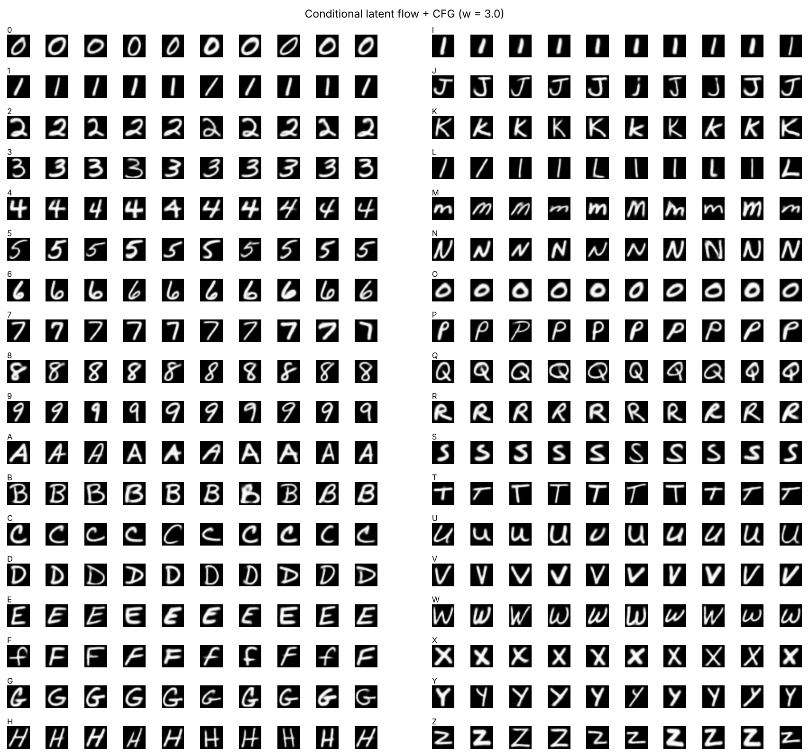
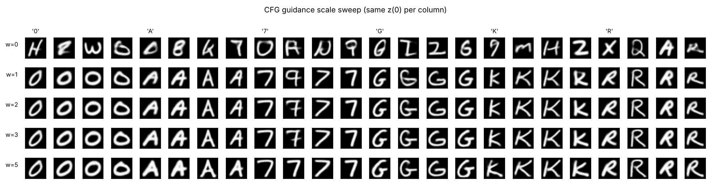
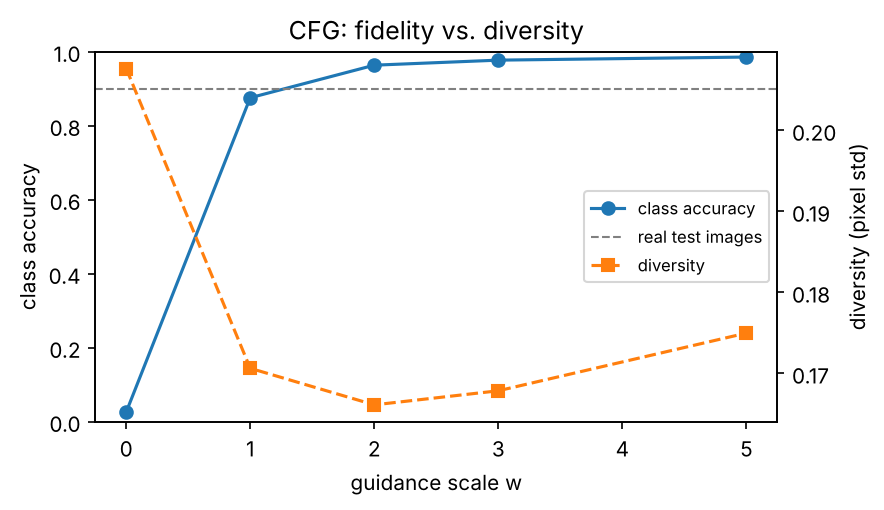
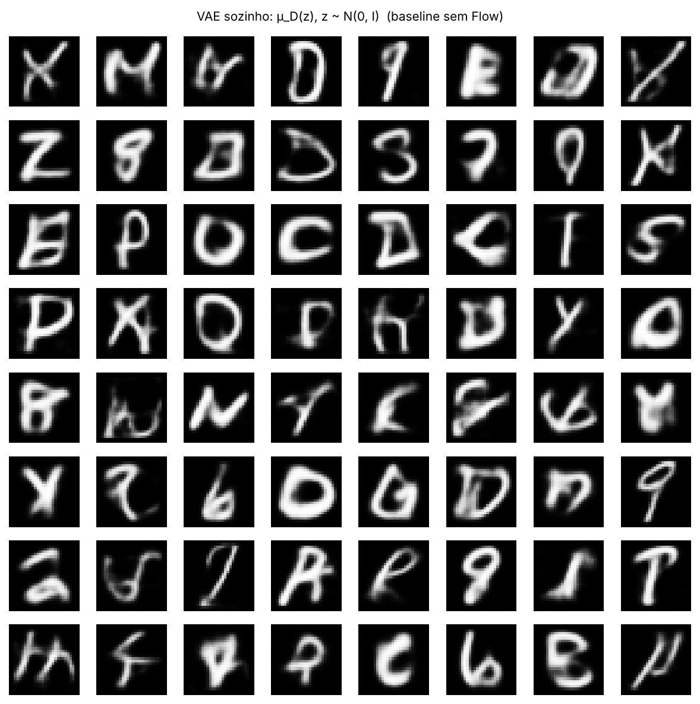

# Latent Rectified Flow no EMNIST (36 classes)

[](https://colab.research.google.com/github/Gui-Domenico-UFMG/ia-generativa-ufmg-latent-flow/blob/main/notebooks/final_task.ipynb)

Trabalho Prático Final de **Inteligência Artificial Generativa (UFMG, 2026/2)**, do Prof. Vinicius M. Gonçalves. Feito pelo **Grupo 4**: Guilherme Martins Dijan Domenico, João Paulo Lara Pinto e Fábio.

Geramos caracteres manuscritos (`0–9`, `A–Z`) em três etapas: um **VAE** comprime as imagens 28×28 num latente de 16 dimensões, um **Rectified Flow** aprende a levar ruído $\mathcal N(0, I)$ até esse latente, e o decoder do VAE transforma o resultado em imagem. Como bônus, o campo de velocidade é **condicionado na classe** e amostrado com **Classifier-Free Guidance**.



---

## Pipeline

```text
                 treino                                          geração
x ──► Encoder ──► μ_E(x) = z(1) ─┐            z(0) ~ N(0, I)
                                 │ flow                │  dz/dt = Φ(z, t, c)   (Euler / Heun)
         z(t) = (1-t) z(0) + t z(1)  ──►  Φ(z,t,c) ≈ z(1) - z(0)                 ▼
                                                              z(1) ──► Decoder μ_D ──► x
```

| Etapa | O que fizemos | Onde no notebook |
| :--- | :--- | :--- |
| Dados | EMNIST `balanced` filtrado para 36 classes: 86.400 imagens de treino e 14.400 de teste | *Functions to load…* |
| VAE | CNN com m = 16, loss $R(x) + \beta L(x)$ do enunciado, β = 0,25 (com comparação de vários β) | *VAE training*, *β analysis* |
| CVAE | Encoder e decoder recebem a classe (embedding), outra forma de controlar a geração | *CVAE training* |
| Flow Φ(z, t) | MLP residual com embedding senoidal do tempo, flow matching, samplers Euler e Heun | *Latent Flow* |
| **Bônus: Φ(z, t, c) + CFG** | Embedding de classe + token nulo, *label dropout* de 15%, $v = \Phi_\varnothing + w(\Phi_c - \Phi_\varnothing)$ | *Bonus (+5)* |

## Resultados

**Bônus: flow condicional + CFG** (`results/cfg_flow/`). Φ(z, t, c) com 0,97M parâmetros, 100 épocas nos latentes do VAE (~5 min de CPU). Um CNN treinado no EMNIST real (acurácia de **89,8%** no teste real) classifica 3.600 amostras geradas (100 por classe):

| Sampler | Passos | *w* | Acurácia de classe | Confiança | Diversidade |
| :--- | :---: | :---: | :---: | :---: | :---: |
| Heun | 25 | 0 (incondicional) | 2,6% (acaso = 2,8%) | 0,03 | 0,208 |
| Heun | 25 | 1 (condicional puro) | 87,6% | 0,83 | 0,171 |
| Heun | 25 | 2 | 96,4% | 0,93 | 0,166 |
| Heun | 25 | **3** | **97,7%** | 0,94 | 0,168 |
| Heun | 25 | 5 | 98,6% | 0,95 | 0,175 |
| Euler | 10 | 3 | 97,8% | 0,94 | 0,154 |
| Euler | 50 | 3 | 97,8% | 0,94 | 0,165 |
| Heun | 5 | 3 | 97,7% | 0,94 | 0,166 |

- **O CFG funciona:** com *w* = 0 a classe é ignorada (acurácia no nível do acaso). Com *w* = 1 já acerta 88%, e com *w* ≥ 2 passa de 96%, acima até das imagens reais, porque o guidance gera versões mais "típicas" de cada caractere.
- **Custo:** *w* maior troca diversidade por fidelidade. O ponto de equilíbrio fica em *w* ≈ 2–3.
- **Sampler:** como o caminho do Rectified Flow é quase reto, 5 passos de Heun ou 10 de Euler já bastam.

| Efeito do guidance *w* (mesmo z(0) em cada coluna) | Fidelidade × diversidade |
| :---: | :---: |
|  |  |

**VAE** (`results/base_vae/`): reconstrução no teste $R(x) = 5{,}37$ (MSE ≈ 0,014 por pixel), todas as 16 dimensões ativas, $\mu_E(x)$ com média ≈ 0 e desvio ≈ 0,97.

| Reconstruções do VAE | VAE sozinho, amostrando de N(0, I) (baseline) |
| :---: | :---: |
|  |  |

Sem o Flow, as amostras de $\mathcal N(0, I)$ saem misturadas ou borradas, porque o latente real não é exatamente gaussiano. O Flow corrige isso, e o CFG ainda permite escolher qual caractere gerar.

## Como rodar

1. Clique no badge **Open in Colab** e selecione *Ambiente de execução → Alterar tipo → GPU T4*.
2. Rode *Ambiente de execução → Executar tudo*. O EMNIST é baixado automaticamente, com um espelho no GitHub caso o NIST esteja fora do ar.
3. No final do notebook há dois widgets para digitar um caractere e gerar amostras: um usa o CVAE + flow, o outro usa o flow com CFG e um controle deslizante para *w*.

Localmente: `pip install -r requirements.txt` e abra `notebooks/final_task.ipynb` no Jupyter.

## Estrutura do repositório

```text
notebooks/final_task.ipynb   # ENTREGA: notebook completo (dados, VAE, CVAE, Flow, CFG, widgets)
results/base_vae/            # VAE de referência: pesos, latentes, métricas e figuras
results/cfg_flow/            # flow condicional + CFG: pesos, métricas e figuras
tools/cfg_cells.py           # código da seção de CFG (fonte das células do notebook)
tools/add_cfg_section.py     # insere/atualiza essa seção no notebook
docs/enunciado.md            # resumo técnico do enunciado (equações, regras de entrega)
docs/plano_de_ensino.md      # plano de ensino da disciplina
legacy/                      # primeira versão em scripts (src/, train_vae.py), já não é necessária
CHANGELOG.md                 # quem fez o quê e quando
```

## Entrega

| Evento | Data | Detalhes |
| :--- | :---: | :--- |
| Código (link do Colab) + PDF dos slides | **30/11/2026, 23:59** | e-mail para vinicius.marianog@gmail.com, assunto `[GENERATIVE AI-2026/2] {NOME DE UM INTEGRANTE}` |
| Apresentação | **01/12/2026** | 15 min no Google Meet |

### Checklist

> Registre o que fizer no [CHANGELOG.md](CHANGELOG.md).

- [x] Cadastro do grupo (**Grupo 4**) na [planilha oficial](https://docs.google.com/spreadsheets/d/1G2pjP_xNPxVwiSrMmVFaKX7bPj9JlPQ13X7mQiDTp4s/edit?usp=sharing)
- [x] Dataloader EMNIST-36
- [x] VAE: treino e validação (reconstruções, PCA, β)
- [x] CVAE
- [x] Flow Φ(z, t) + samplers Euler e Heun
- [x] **Bônus:** Φ(z, t, c) + Classifier-Free Guidance
- [ ] Rodar *Executar tudo* no Colab com GPU e salvar o notebook com as saídas
- [ ] Slides em PDF (15 min), salvos em `docs/`
- [ ] Enviar o e-mail até 30/11 às 23:59
