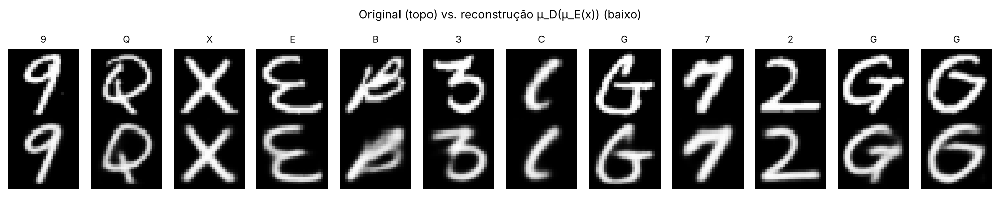

# Trabalho Prático Final — IA Generativa (UFMG 2026/2)
## Latent Diffusion / Rectified Flow no Dataset EMNIST (36 Classes)

Repositório do grupo para o **Trabalho Prático Final** da disciplina de **Inteligência Artificial Generativa (2026/2)** da **UFMG**, ministrada pelo **Prof. Vinicius M. Gonçalves**.

---

## 1. Visão Geral do Trabalho

- **Pontuação:** **20 pontos** + até **5 pontos extras (bônus)**.
- **Dataset:** **EMNIST** — variante contendo **36 classes** (`10 dígitos` de `0` a `9` + `26 letras` de `A` a `Z`).
- **Framework obrigatório:** **PyTorch**.
- **Tamanho do Grupo:** Até 3 integrantes.
  - **Planilha de Cadastro dos Grupos:** [Google Sheets Oficial](https://docs.google.com/spreadsheets/d/1G2pjP_xNPxVwiSrMmVFaKX7bPj9JlPQ13X7mQiDTp4s/edit?usp=sharing)

---

## 2. O Que Precisa Ser Feito (Resumo Técnico)

O objetivo é gerar novos caracteres manuscritos do EMNIST combinando **redução de dimensionalidade via VAE** com um **modelo de fluxo (Rectified Flow)** no espaço latente:

### Etapa 1 — Variational Autoencoder (VAE — Parte 5)
Treinar um modelo de **VAE** ($\mu_E, \sigma_E, \mu_D$) para comprimir as imagens $x \in \mathbb{R}^n$ ($28 \times 28 = 784$) em um espaço latente $\mathbb{R}^m$ ($m \ll n$):
- **Encoder Probabilístico:**
  $$Z(x) = \mu_E(x) + \sigma_E(x) W_E, \qquad W_E \sim \mathcal{N}(0, I)$$
- **Decoder:**
  $$\hat{x} = \mu_D(z)$$
- **Função Objetivo do VAE (Slides 55–59 da Parte 5):**
  $$\min_{\mu_D, \mu_E, \sigma_E} \sum_{i=1}^N \Big\{ R(x_i; \mu_D, \mu_E, \sigma_E) + L(x_i; \mu_D, \mu_E, \sigma_E) \Big\}$$
  onde:
  - **Erro de Reconstrução ($R$):**
    $$R(x; \mu_D, \mu_E, \sigma_E) = \mathbb{E}_W \left[ \frac{\|x - \mu_D(\mu_E(x) + \sigma_E(x)W)\|^2}{2} \right]$$
  - **Erro de Distribuição Latente ($L$):**
    $$L(x; \mu_D, \mu_E, \sigma_E) = m \left( \frac{\sigma_E(x)^2 - 1}{2} - \ln(\sigma_E(x)) \right) + \frac{\|\mu_E(x)\|^2}{2}$$

### Etapa 2 — Campo de Velocidade no Espaço Latente ($\Phi$ — Parte 6)
Treinar uma rede neural que parametriza o **campo de velocidade ($\Phi$)** no espaço latente do VAE:
- **Interpolação Retificada (Parametrização Forward $t \in [0, 1]$):**
  - Ponto inicial (ruído latente em $t=0$): $z(0) \sim \mathcal{N}(0, I)$
  - Ponto final (latente codificado em $t=1$): $z(1) = \mu_E(x)$ (ou amostrado do encoder)
  - Caminho reto entre $z(0)$ e $z(1)$:
    $$z(t) = (1 - t)\,z(0) + t\,z(1)$$
- **Treinamento via Flow Matching:**
  $$\min_{\theta} \frac{1}{M} \sum_{i=1}^M \left\| \Phi\big(z_i(t_i), t_i; \theta\big) - \big(z_i(1) - z_i(0)\big) \right\|^2$$

### Etapa 3 — Geração de Novas Imagens (Amostragem)
1. Amostrar um vetor latente inicial a partir da distribuição normal padrão:
   $$z(0) \sim \mathcal{N}(0, I)$$
2. Refinar esse vetor latente integrando a EDO $\frac{dz}{dt} = \Phi(z(t), t)$ de $t=0$ até $t=1$ (usando *Sampler* de **Euler** ou **Heun**), obtendo o latente final $z(1)$.
3. Decodificar $z(1)$ com o decoder do VAE para obter a imagem gerada:
   $$x = \mu_D(z(1))$$

### Etapa 4 (Bônus: +5 Pontos) — Condicionamento & Classifier-Free Guidance (Parte 7)
- Incluir um sinal de condicionamento $c \in \{0, 1, \dots, 35\}$ na rede de velocidade $\Phi(z, t, c)$ para controlar qual das **36 classes** (26 letras + 10 dígitos) será gerada.
- Implementar **Classifier-Free Guidance (CFG)** combinando a predição condicional e incondicional ($\varnothing$) durante a amostragem:
  $$v_{\text{CFG}}(z, t, c) = \Phi(z, t, \varnothing) + w \cdot \big(\Phi(z, t, c) - \Phi(z, t, \varnothing)\big)$$

---

## 3. Decisões de Engenharia do Grupo

Fica a critério do grupo definir e experimentar:
- Arquitetura das redes neurais do VAE ($\mu_E, \sigma_E, \mu_D$) e do campo de velocidade ($\Phi$)
- Número de parâmetros e camadas
- Dimensão $m$ do espaço latente
- Hiperparâmetros de treinamento e método de integração numérica (*Euler* vs. *Heun*, número de passos $\Delta t$)

---

## 4. Prazos e Regras de Entrega

| Evento | Data / Horário | Detalhes |
| :--- | :---: | :--- |
| **Entrega Final (Código + PDF)** | **30/11/2026 até 23:59** | Enviar **link/código no Google Colab** + **PDF da apresentação** por e-mail |
| **Apresentação Online** | **01/12/2026** | Apresentação de **15 minutos** via Google Meet (em Português ou Inglês) |

### Instruções de Envio do E-mail
- **Destinatário:** [vinicius.marianog@gmail.com](mailto:vinicius.marianog@gmail.com) (enviado por apenas **um membro** do grupo)
- **Assunto obrigatório do e-mail:**
  ```text
  [GENERATIVE AI-2026/2] {NOME DE UM INTEGRANTE DO GRUPO}
  ```

---

## 5. Checklist de Tarefas para o Grupo

> 📝 **Registre o que você fez no [CHANGELOG.md](CHANGELOG.md)** e marque seu nome na tabela "Em andamento" antes de pegar uma tarefa.

- [ ] Cadastrar o grupo na [planilha oficial](https://docs.google.com/spreadsheets/d/1G2pjP_xNPxVwiSrMmVFaKX7bPj9JlPQ13X7mQiDTp4s/edit?usp=sharing)
- [ ] Preparar o carregamento e pré-processamento do dataset **EMNIST (36 classes)** em PyTorch
- [ ] Definir a arquitetura e treinar o **VAE** ($\mu_E, \sigma_E, \mu_D$)
- [ ] Avaliar a qualidade de reconstrução e a organização do espaço latente do VAE
- [ ] Definir a arquitetura e treinar o modelo de **Flow ($\Phi$)** no espaço latente
- [ ] Implementar o *Sampler* ($z(0) \to z(1)$) e validar a geração $x = \mu_D(z(1))$
- [ ] **(Bônus +5 pts)** Implementar o condicionamento nas 36 classes + **Classifier-Free Guidance (CFG)**
- [ ] Consolidar o notebook final no **Google Colab**
- [ ] Montar os slides da **apresentação em PDF** (15 min)
- [ ] Enviar o e-mail até **30/11/2026 às 23:59**

---

## 6. Base do Projeto (Dados + VAE) — como usar

### Estrutura
```text
src/dataset.py      # EMNIST com 36 classes ('0'-'9', 'A'-'Z'), imagens em [0, 1], orientação corrigida
src/vae.py          # VAE (μ_E, σ_E, μ_D), loss R(x) + β·L(x), save_vae / load_vae / encode_dataset
src/vis_vae.py      # figuras: reconstruções, amostras de N(0, I), interpolação, PCA do latente, curvas
train_vae.py        # treina o VAE e exporta vae.pt + latents.pt + figuras para outputs/
notebooks/01_base_dados_vae.ipynb   # mesma coisa, pronto para o Colab (autossuficiente)
tools/build_notebook.py             # regera o notebook a partir de src/ (rode após mudar o código)
```

### Rodar
- **Colab (recomendado):** abra `notebooks/01_base_dados_vae.ipynb`, escolha GPU e execute tudo.
- **Linha de comando:**
  ```bash
  pip install -r requirements.txt
  python train_vae.py                    # m=16, β=0.25, 30 épocas
  python train_vae.py --fake --epochs 2  # teste rápido sem baixar o EMNIST
  ```

### Dataset
Split `balanced` do EMNIST (se o site do NIST falhar, o código baixa de um espelho no GitHub) filtrado para os rótulos `0..35`: **86.400** imagens de treino e **14.400** de teste, 2.400/400 por classe.
Rótulo `0..9` → dígito, `10..35` → letra `A..Z` (`src.dataset.index_to_char`).

### Resultados do treino (já no repositório, em `results/base_vae/`)
Treino de 20 épocas (m = 16, β = 0.25, σ diagonal, 2,41M parâmetros), melhor época 19:

| Métrica (teste) | Valor |
| :--- | :---: |
| Reconstrução R(x) = ‖x − x̂‖²/2 | **5,37** (MSE ≈ 0,0137 por pixel) |
| Latente L(x) | 23,0 |
| Dimensões ativas | **16/16** |
| μ_E(x): média / desvio | −0,001 / 0,97 (já quase N(0, I), não precisa normalizar) |

| Reconstruções | Amostras do VAE sozinho (baseline) |
| :---: | :---: |
|  |  |

As reconstruções são nítidas e com o caractere certo. As amostras de N(0, I) sem Flow saem parecidas com caracteres, mas muitas ficam misturadas ou borradas: **é isso que o Flow precisa melhorar**. O PCA (`vae_latent_pca.png`) mostra as classes sobrepostas em 2D, o que é esperado com 16 dimensões e reforça a utilidade do condicionamento/CFG.

> **Quem vai fazer o Flow não precisa treinar o VAE de novo:** use `results/base_vae/vae.pt` e `results/base_vae/latents.pt`.

### O que a base entrega para o Flow (Φ)
| Arquivo | Conteúdo |
| :--- | :--- |
| `results/base_vae/vae.pt` | pesos + config do VAE → `vae = load_vae("results/base_vae/vae.pt", device)` |
| `results/base_vae/latents.pt` | `{"train": {"mu", "sigma", "y"}, "test": {...}, "latent_dim", "class_names", "mu_mean", "mu_std"}` |

```python
from src.vae import load_vae
vae = load_vae("results/base_vae/vae.pt", device)
lat = torch.load("results/base_vae/latents.pt")
z1, y = lat["train"]["mu"], lat["train"]["y"]   # z(1) = μ_E(x) e classe c ∈ {0..35}
x = vae.decode(z1_gerado)                       # x = μ_D(z(1))
```

### Sobre o β
`β = 1` é a fórmula exata do enunciado. Como $R(x) = \|x-\hat x\|^2/2$ com pixels em [0, 1] fica pequeno perto de $L(x)$, `β = 1` tende a borrar as imagens e desligar dimensões do latente. O padrão é `β = 0.25`. O notebook tem uma célula opcional que compara β ∈ {1, 0.25, 0.05}, útil para o slide de decisões de engenharia.
